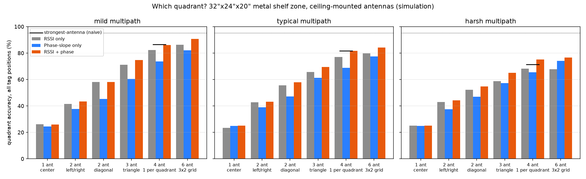
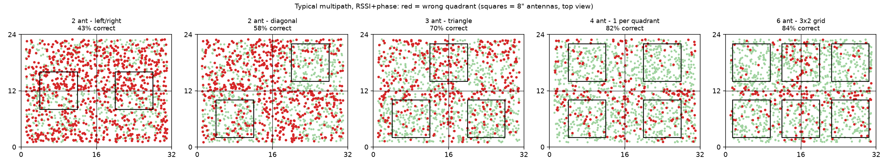

# Smart Driver — quadrant localization on a metal shelf (RSSI + phase)

**Question:** one shelf zone is 32" L × 24" D × 20" H on metal shelving, split into 4
quadrants of 16" × 12". The boxes are stationary. How many antennas does it take to say
with confidence which quadrant a tagged package is in (within 1–1.5 ft), using
Impinj phase and RSSI?

**Short answer: 4 antennas per zone, one centered over each quadrant on the underside
of the shelf above. Use RSSI and phase-slope together, with a one-time fingerprint
calibration per shelf design.** One R700 (4 ports) per zone.

| | 1 ant | 2 ant | 3 ant | **4 ant** | 6 ant |
|---|---|---|---|---|---|
| Quadrant, model-based, typical multipath | 25 % (chance) | 43–58 % | 70 % | **82 %** | 84 % |
| Quadrant, fingerprinted, typical / harsh | – | – | 82 / 75 % | **87 / 82 %** | 88 / 85 % |
| …same, tag ≥ 3" from a quadrant boundary | – | – | 88 / 82 % | **92 / 91 %** | 96 / 91 % |
| …top-2 ("FL or FR") correct | – | – | 97 / 95 % | **98 / 96 %** | 99 / 97 % |
| Position error < 12" (fingerprinted) | – | – | 96 / 95 % | **99 / 98 %** | 99 / 97 % |
| Position error < 18" (fingerprinted) | – | – | 99 / 99 % | **~100 / ~100 %** | ~100 / 99 % |

All numbers are from simulation (see [sim/](sim/)) and need to be confirmed on a real shelf
(test plan below).

- **1–2 antennas cannot do quadrants.** One antenna gives range only, which is a circle,
  so it can't tell left from right. Two antennas leave mirror-image pairs ambiguous.
- **3 is the geometric minimum** but loses 5–10 points compared with 4.
- **6 adds only 1–4 points** over 4: diminishing returns, and a 6-port setup needs a second reader or an antenna hub.
- **The 1–1.5 ft requirement is met with 4 antennas.** About 98–99 % of tags are placed
  within 12", and ~100 % within 18".
- **A single hard quadrant call can't be 95 %+ for every box.** Boxes sitting on or near
  the quadrant center lines are inherently ambiguous; the error maps show the misses
  cluster there. Report a quadrant only when confident and otherwise report the top 2,
  or add a physical divider/lip at the boundaries (see recommendations).




---

## What carried over from the Walmart work, and what changed

Walmart used a moving tag: the phase V-shape is centered on the photo-eye (PE)
trigger. On a shelf nothing moves, so there is **no V-shape and no time-of-closest-approach**.
The only phase information left is **phase vs frequency**: the per-channel phase is a line in
frequency whose slope is the round-trip range. This is the same method as
`Walmart/phase_capture/estimate_distance.py`.

Two findings from re-analysing the Walmart reference captures (`ref_*.csv`):

1. **The 180° phase ambiguity is real in your data.** The same tag on the same channel
   flips by π between reads. Per-read phase jitter within a channel:

   | capture | raw phase std | mod-180 std |
   |---|---|---|
   | ref_1ft | 28.8° | **4.4°** |
   | ref_2ft | 30.2° | **2.0°** |
   | ref_3ft | 50.3° | **6.1°** |
   | ref_5ft | 64.9° | **4.4°** |

   Fix: work on the doubled angle `exp(j·2φ)`. The Walmart code doesn't do this yet; its
   slope fits survived only because the circular mean tolerates the flips. **All shelf
   processing must use mod-180 phase.** This is worth back-porting to Walmart too.

2. **Absolute single-antenna phase-slope ranging is multipath-limited to ~25–50 cm.** The
   ft-series refs give slopes of 23.9 → 28.8 → 28.4 → 29.7 °/MHz at 1/2/3/5 ft. Theory
   says the slope should change by 2.4 °/MHz per meter, but from 2 ft to 5 ft it barely moves.
   The metric series (30/62/90 cm) gives 3.9 °/MHz/m instead of 2.4. A 25–50 cm error is
   about the size of a quadrant, so **phase alone, one antenna, cannot pick a quadrant**.
   What helps:
   - **Range differences across antennas.** The unknown tag offset and tag detuning slope
     are common to all antennas, so they cancel.
   - **Fingerprinting.** The metal structure is fixed, so its multipath is repeatable.
     A fingerprint learns it once.

   I also tried sub-wavelength phase "holography" and rejected it: with the π ambiguity it
   has grating lobes every ~3", and it picks the wrong lobe even with zero multipath.

## Recommendations

1. **Antennas:** 4 per zone, one centered above each quadrant on the underside of the shelf
   above, facing down. Use small circularly polarized patches (≤ 8" × 8"). One R700 per zone.
   If an antenna hub serves several zones, the scan time grows proportionally.
2. **Read settings:** Session 2 with DualTarget so stationary tags keep replying; report
   phase, channel, antenna port and peak RSSI (same as the Walmart `Program.cs`). **Dwell
   ≥ 20 s** so every antenna sees all 50 channels; the Walmart refs needed 19–40 s for full
   50-channel coverage. RSSI-only gives a faster preliminary answer.
3. **Tx power:** sweep it (e.g. 15 / 20 / 25 dBm). Lower power sharpens the RSSI contrast
   between the near antenna and the far ones, but needs every tag still read by ≥ 2 antennas.
4. **Calibration:**
   - Put a **fixed reference tag** in each zone to remove the per-port cable/reader phase
     term and track drift.
   - Do a **one-time fingerprint survey per shelf design**. In the simulation, training on
     one van and testing on another costs only 0–3 points.
5. **Output:** report the quadrant when the posterior is ≥ 0.9. That call is 97–99 %
   correct and covers ~40–50 % of tags. Otherwise report the top-2 adjacent quadrants
   ("front-left / front-right"), which is ~96–98 % correct and still within 1–1.5 ft.
6. **Mechanical (cheapest accuracy win):** most remaining errors are within ~3" of the
   center lines. A divider, lip or marked keep-out band at the quadrant boundaries lifts
   hard-call accuracy to ~91–92 % with 4 antennas (fingerprinted, typical/harsh).

## Test plan (to confirm or replace the simulation numbers)

1. **Survey (no ML).** On one zone, place a tagged box at a 4 × 3 grid per quadrant
   (48 spots) × 2 heights × 2 label orientations. Measure per-antenna RSSI and mod-180
   slope-range. Compare the residual spreads with `sim/results/sigmas.json` to see whether
   the real shelf behaves like *mild*, *typical* or *harsh*. That tells you which column
   of the table to trust.
2. **Fingerprint.**
   - Train on ~200–300 random placements with realistic neighbouring boxes.
   - Test on a separate set, first on an empty shelf, then on a full shelf.
3. **Transfer.** Apply the model trained in step 2 to a second zone or van of the same design.
4. **Ablations:** 3 vs 4 antennas (just disable a port), RSSI-only vs RSSI + phase, and
   Tx power.
5. **Acceptance metrics:**
   - hard-call accuracy
   - accuracy and coverage at posterior ≥ 0.9
   - top-2 accuracy
   - P(error < 12") and P(error < 18")
   - P(tag read by ≥ 2 antennas)

## Tools for the hardware test

```
shelf_config.json        zone size, antenna port → position, reference tag EPC + position, reader settings
capture/                 ShelfCapture (C#, Octane SDK 5.1, net8) — 4-port stationary capture
analysis/shelfloc.py     shared processing: mod-180 phase-slope ranging, cable calibration, localizers
analysis/survey_analyze.py   QC + error sizes + accuracy (CV or train/test) + 3-antenna ablation
analysis/locate.py       locate every tag in a scan capture using survey sessions as training data
sim/make_fake_session.py fake sessions in the capture format (tests the pipeline without hardware)
```

**1. Set up** `shelf_config.json`:
- measure the antenna centers
- fix a reference tag where all 4 antennas read it, and enter its EPC and position
- set the reader IP

**2. Capture.** Each run writes to `sessions/<name>/`. The survey mode is resumable: rerun
the same command and it skips placements already captured.

Run it with `capture\run.cmd`. That uses the user-local .NET 8 SDK in
`%USERPROFILE%\.dotnet`; the system `dotnet` on this PC has runtimes only. On a machine
with an SDK on PATH, `dotnet run -- …` from `capture/` works the same.

```bash
capture/run.cmd --epc <TEST_TAG_EPC> --session van1_grid                       # guided 8x6 grid x 2 heights x 2 orientations (192)
capture/run.cmd --mode random --random 150 --seed 2 --epc <EPC> --session van1_random   # held-out test set
capture/run.cmd --mode scan --session van1_scan --dwell 30                     # real use: all boxes, unknown positions
```

The tool tells you where to put the box, then shows live per-port channel coverage and
RSSI while it captures. It stops early once every port has seen ≥ 48 channels, and warns
when the tag was read by fewer than 2 antennas or the reference tag was missed.

Useful options:
- `--power 15` for the Tx power sweep
- `--heights 4,12`
- `--orients top,side`

**3. Analyze**

```bash
python analysis/survey_analyze.py sessions/van1_grid --test sessions/van1_random sessions/van2_random
python analysis/locate.py sessions/van1_scan --train sessions/van1_grid sessions/van1_random
```

`survey_analyze` reports:
- per-port QC, including the 180° ambiguity check (raw vs mod-180 phase jitter)
- the cable term per port
- measured range and RSSI error sizes, and which simulation severity they match
- the accuracy table for fingerprint and model-based methods, each with RSSI, phase, and both
- the same table with each port dropped, which answers "is 3 antennas enough?" from real data

`locate` outputs per tag:
- the quadrant and its confidence
- a call: one quadrant if confidence ≥ 0.9, otherwise the top-2 pair (e.g. `FL/FR`)
- an estimated x/y

**Cable calibration.** Each port's cable/reader phase slope (~8 m equivalent) is removed
using the **session median** of the reference tag. Calibrating per capture was tried and
rejected: the reference tag's own multipath shifts as boxes move, which adds 25–35 cm of
noise per port. A different van calibrates from its own reference tag.

**Pipeline check on fake data** (typical multipath; train on the fake grid, test on random
spots in the same van and a second van):

| | Quadrant correct | Correct when ≥ 3" from a boundary | Top-2 correct | Within 12" |
|---|---|---|---|---|
| Fingerprint, RSSI + phase | 89 % | 96 % | 99 % | 99 % |
| Model-based, RSSI + phase | 87 % | 89 % | 98 % | 94 % |

In the fake 6-box scan, all 6 boxes land in the correct quadrant. The 2 boxes near the
center lines are reported as top-2 pairs.

## Hardware findings so far (R700, Nov 2026)

- **RF mode:** use **1002** (AutoSet Dense Reader Deep Scan). Mode 4120, carried over from
  Walmart, never read the on-metal reference tag, and its phase noise was 6–10° against
  1–4° in 1002. Both configs now default to 1002.
- **Tx power:** at ≤ 12 dBm each tag was read by only one of two side-wall antennas.
  About 17–20 dBm was needed for both. Lowering power shrinks the read zone; it does not
  reduce multipath on the tags that are still read.
- **Phase measurement is reliable; phase as position is not (side-wall antennas):**
  - The same spot after re-placing the box gives a phase-pattern match of 0.90–0.95.
  - Phase-slope ranging is off by metres.
  - The per-channel pattern changes completely within 1–4": a match of 0.50 at 4" against 0.37 at 20".
  - Tags that never moved lost their pattern (match 0.1–0.5) when another box came within about 12".
- **2 antennas on the side walls, 2×2 quadrants (48-spot survey):** 27 % correct with RSSI
  and 40 % with RSSI + phase pattern (chance = 25 %). Left/right was 58–75 %. Each antenna
  read the far side of the shelf best.

## 4 side-by-side zones, one antenna per zone (current plan)

`shelf_config_4zone.json`:
- 4 zones of 12" along the shelf, ports 1–4 = zones 1–4
- antennas at the aisle edge, centered on their zone, facing in
- **Measure and correct:** the depth, the antenna positions and heights, and the
  reference tag position

The analysis adds:
- **strongest antenna**: no training needed
- **within 1 zone** and a confusion matrix
- **per-antenna RSSI maps**

### First: one box per zone center, then rotate the boxes

Four boxes, one per zone, at the zone center with the tag 12" deep:
- `0261` in zone 1
- `0650` in zone 2
- `0654` in zone 3
- `0661` in zone 4

Each capture reads all four boxes. `analysis/zone_centers.py` shows, per box and antenna:
- RSSI, phase noise and phase-slope distance against the tape-measured distance
- the zone call
- how similar the per-channel phase patterns are between captures and between boxes

```bash
capture/run.cmd --mode scan --powers 12,15,20 --dwell 20 --config ..\shelf_config_4zone.json --session 4zone_centers
.venv\Scripts\python analysis\zone_centers.py sessions\4zone_centers
```

With one box per spot you can't tell whether a phase pattern belongs to the spot or
to the box. Every tag chip has its own phase response.

**Rotation test.** Move every box one zone to the right, so the zone-4 box goes to
zone 1, and capture again. Repeat. The 4th move brings every box back to its start
spot, which also gives the "put back" repeat.

```bash
capture/run.cmd --mode scan --powers 12,15 --dwell 20 --config ..\shelf_config_4zone.json --session 4zone_rot1
capture/run.cmd --mode scan --powers 12,15 --dwell 20 --config ..\shelf_config_4zone.json --session 4zone_rot2
capture/run.cmd --mode scan --powers 12,15 --dwell 20 --config ..\shelf_config_4zone.json --session 4zone_rot3
capture/run.cmd --mode scan --powers 12,15 --dwell 20 --config ..\shelf_config_4zone.json --session 4zone_rot4
.venv\Scripts\python analysis\zone_centers.py sessions\4zone_centers sessions\4zone_rot1 sessions\4zone_rot2 sessions\4zone_rot3 sessions\4zone_rot4 --rotate
```

Phase marks the spot only if both of these hold:
- "SAME SPOT, different box" matches close to "same box, same spot, put back"
- both are clearly above "same box, different spot"

The script also scores a phase-only zone call that uses the other sessions as the
lookup table, against strongest RSSI.

**Result (Nov 10, 2026):**
- The phase-only call got 40/40 readings right; strongest RSSI got 30/40, and every
  miss was zone 3 called zone 4.
- Different boxes at the same spot matched 0.9 or better on that zone's antenna; the same
  box at a different spot matched a median of 0.37.
- The pattern around zone 2 changed between rot1 and rot2 and did not come back.

**12 boxes, 3 per zone (front y≈6", middle 12", back 18"), Nov 10, 2026** (`sessions\4zone_12box`; the box layout is in its `layout.json`):
- **Reads:** every box is read on at least 3 antennas, with about 1–2° phase noise.
- **Strongest RSSI:** only 12/24 right. Middle row 6/8, front 4/8, back 2/8. Front boxes are
  10–20 dB weaker on their own antenna than the middle box, even though they are closer to it.
- **Phase pattern, using the centered rotation sessions as the lookup table:**
  - Middle row: 7/8. Its pattern survived 8 extra boxes; own-antenna match about 0.95.
  - Front and back: 10/16. Their own-zone scores (0.4–0.7) are barely above the other zones'.
- **Within one capture, boxes in the same zone at other depths are no more alike than
  boxes in other zones** (match 0.24–0.50 against 0.33–0.41). The most similar box was in the
  same zone for 3/12 boxes.
- **Conclusion:** the phase pattern marks the exact spot, not the zone. A phase lookup needs
  every spot surveyed.

**Off-center test.** Every box goes back to its start zone, then all four are moved the
same 3" from the center, in one direction per session. Each session folder already
has a `layout.json` with the direction:

| Session | Move |
|---|---|
| `offL` | 3" left (dx = −3) |
| `offR` | 3" right (dx = +3) |
| `offA` | 3" toward the aisle (dy = −3, tag at y = 9") |
| `offB` | 3" toward the back (dy = +3, tag at y = 15") |

The off-center readings are looked up only against the centered ones.

```bash
capture/run.cmd --mode scan --powers 12,15 --dwell 20 --config ..\shelf_config_4zone.json --session 4zone_offL
capture/run.cmd --mode scan --powers 12,15 --dwell 20 --config ..\shelf_config_4zone.json --session 4zone_offR
capture/run.cmd --mode scan --powers 12,15 --dwell 20 --config ..\shelf_config_4zone.json --session 4zone_offA
capture/run.cmd --mode scan --powers 12,15 --dwell 20 --config ..\shelf_config_4zone.json --session 4zone_offB
.venv\Scripts\python analysis\zone_centers.py sessions\4zone_centers sessions\4zone_rot1 sessions\4zone_rot2 sessions\4zone_rot3 sessions\4zone_rot4 sessions\4zone_offL sessions\4zone_offR sessions\4zone_offA sessions\4zone_offB --rotate
```

### Full survey

```bash
# 1. check: all 4 ports + reference tag read, at 3 powers (~30 s)
capture/run.cmd --mode scan --powers 12,15,20 --dwell 10 --config ..\shelf_config_4zone.json --session 4zone_check
# 2. survey: 12 x 3 grid (every 4" along the shelf, 3 depths) x 3 powers (~25-30 min)
capture/run.cmd --mode survey --grid 12x3 --heights 4 --orients top --powers 12,15,20 --dwell 10 --epc <TEST_EPC> --session 4zone_grid --config ..\shelf_config_4zone.json
.venv\Scripts\python analysis\survey_analyze.py sessions\4zone_grid
# 3. neighbour-box test: test box fixed in zone 2, a 2nd box moved to the 27 spots in
#    zones 1/3/4 (nearest first), baselines with the 2nd box removed (~15-20 min)
capture/run.cmd --mode disturb --grid 12x3 --powers 15 --dwell 20 --epc <TEST_EPC> --session 4zone_disturb --config ..\shelf_config_4zone.json
.venv\Scripts\python analysis\stability.py sessions\4zone_disturb --train sessions\4zone_grid
# 4. held-out test at the best power, ideally with other boxes on the shelf
capture/run.cmd --mode random --random 30 --seed 3 --heights 4 --orients top --power 15 --dwell 10 --epc <TEST_EPC> --session 4zone_random --config ..\shelf_config_4zone.json
.venv\Scripts\python analysis\survey_analyze.py sessions\4zone_grid --test sessions\4zone_random
```

**Is phase usable?** Two conditions:
- In step 3, the fixed box's phase-pattern match stays near the same-spot repeat (about 0.9)
  while the neighbour moves.
- The phase-based zone calls stay correct, and in step 2 the phase methods beat RSSI.

Otherwise the zone call has to come from RSSI and hardware: near-field antennas,
power, or dividers. Use `--at x,y` to fix the test box somewhere other than the middle
of zone 2. `stability.py --tag <EPC> --at x,y` also works on any tag that never moved
during a session, such as the reference tag during a survey.

## Simulation model and caveats

`sim/quadrant_sim.py` models:
- image-method multipath from the metal floor, shelf above, back wall and side uprights
  (including floor↔ceiling double bounce)
- random scatterers standing in for other boxes
- patch and dipole patterns and a monostatic `h²` channel
- 50 FCC channels and the π ambiguity
- per-read phase noise matched to the Walmart refs
- RSSI anchored to `ref_30cm` (−32 dBm)
- an unknown per-tag gain (±6 dB) and phase slope (±0.5 °/MHz)
- reference-tag calibration residuals

Caveats:
- Tags here are 4–18" from the antennas, which is radiating near field; the path model is
  far-field.
- Box contents (liquids, metal) are modelled only as random scatterers; blockage and
  absorption aren't.
- The severity levels are guesses, bracketed by the Walmart ranging errors.

Treat the numbers as **relative**: they compare antenna counts and methods. They are not
absolute guarantees.

```bash
python -m venv .venv && .venv/Scripts/python -m pip install numpy pandas matplotlib
.venv/Scripts/python sim/quadrant_sim.py 1500      # model-based, all layouts → sim/results/sim_rows.csv
cd sim && ../.venv/Scripts/python analyze.py        # summary.csv + plots
../.venv/Scripts/python fingerprint.py               # kNN fingerprint results → fingerprint_summary.csv
```

## Zone Locator (test UI)

A local web page for testing the zone call on single tags.

**To start it**, run this from the project folder, then open http://localhost:8765 in a browser. Opening `index.html` straight from disk or the file viewer also works while the server is running, since the page then talks to localhost:8765 directly:

```
.venv\Scripts\python tools\zone_ui\server.py
```

**Using it:**
1. Type an EPC.
2. Choose **Live scan** (runs `capture/run.cmd`, default RF mode 2, Gen2 session S2, dual-target search, 20 dBm, 20 s) or **Saved capture**. For live scans you can change the RF mode, scan time, **Gen2 session** (S0-S3) and **search mode** (dual or single target). Each saved capture records these, and results and the test log show them next to the source.
3. Tick the calibration sessions to use as the lookup table.

It shows a confidence per zone from these sources:
- **Phase pattern:** the best match to any calibration box in that zone.
- **RSSI pattern:** the closest relative-RSSI vector.
- **Slope:** the phase slope across frequency on each antenna (deg/MHz). A longer path gives a steeper slope. Each antenna's cable delay is removed using its median slope over the lookup boxes, and the antenna with the shortest relative path points to the zone. It changes smoothly with position, so it doesn't need the tag to sit on a calibrated spot (`analysis/phase_slope.py`).
- **Combined:** all three. The phase and RSSI patterns only recognise calibrated spots, so they are weighted by how closely the tag matches any lookup box: no weight below a best match of 0.80, full weight above 0.95. Below that, the call leans on the slope, and the page says so.

Tuned on the saved captures (lookup = 4zone_cal32 + repeat):

| Boxes | Before the slope | With the slope |
|---|---|---|
| On a calibrated spot (minutes later and overnight, 15/20 dBm) | 118/128 | 113/128 |
| Off the spots (6" leave-one-out, 12-box) | 42/76 | 50/76 |

The slope on its own gets 54/76 off-spot but only 79/128 on-spot.

It also shows the closest calibration boxes on a shelf map and what each antenna heard.

**After each test:**
- Pick the box's real zone and press **Save result**. The test log (`tools/zone_ui/test_log.csv`) shows overall accuracy, strongest-antenna accuracy, and how often each confidence band is right.
- **Check a whole session** classifies every box of a session with a known layout.

The confidences are rankings, not calibrated probabilities; the log shows how far to trust them. Live scans are saved under `sessions/ui_runs/`. The R700 accepts one connection at a time, so close ItemTest first.
